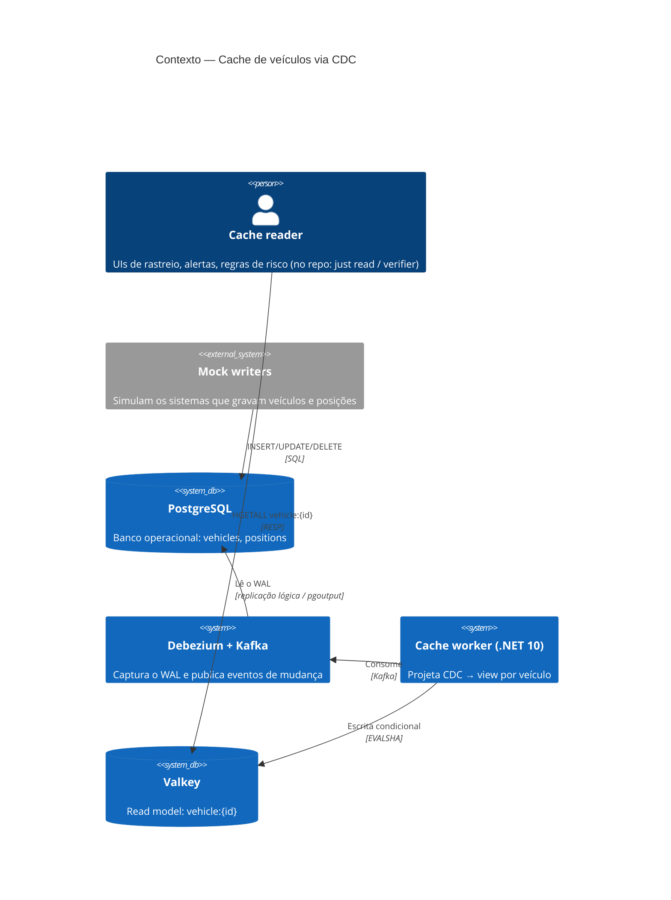
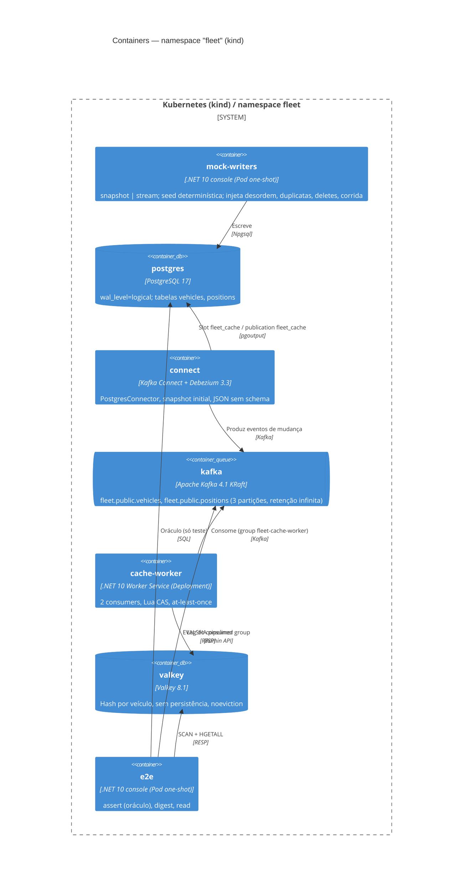
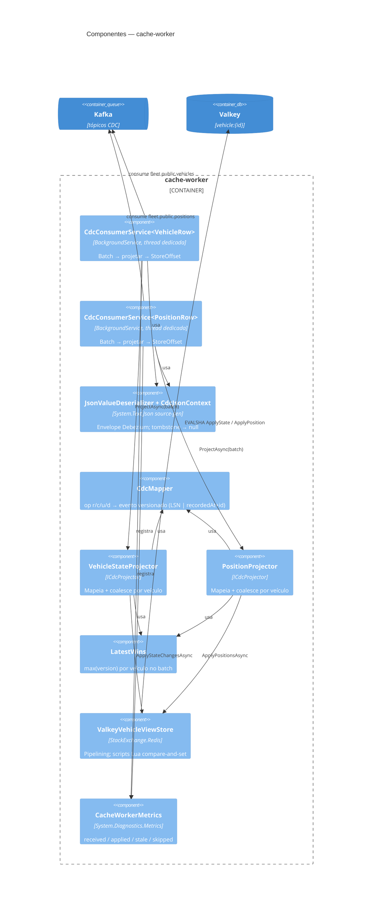
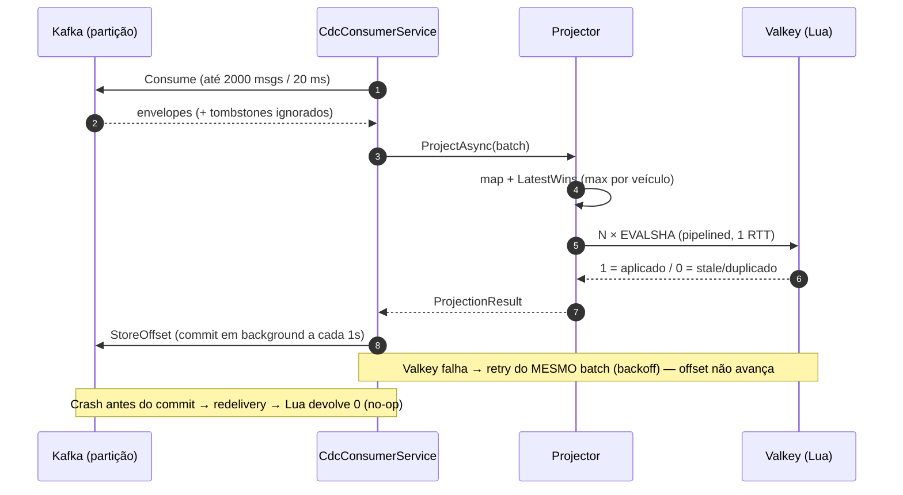

# Modelo C4

Os diagramas refletem exatamente o que o `just e2e` sobe no namespace `fleet` do cluster kind. Para conferir, rode `just status`.

## Nível 1 — Contexto

O worker **não tem relação com o PostgreSQL**. Essa ausência é a restrição central do desafio.

## Nível 2 — Containers

Fora do cluster ficam `just` + `scripts/*.sh` (orquestração), `devspace` (build das 3 imagens e deploy dos manifests) e `devenv` (ferramentas).

## Nível 3 — Componentes do cache-worker

## Sequência — um batch (caminho feliz + falhas)

